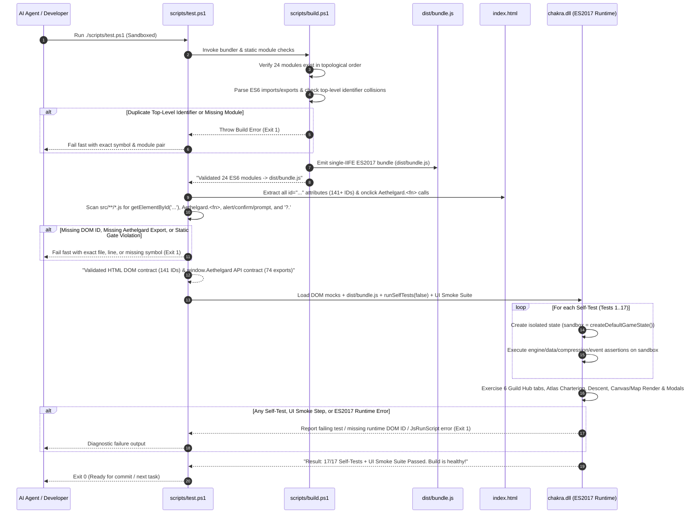
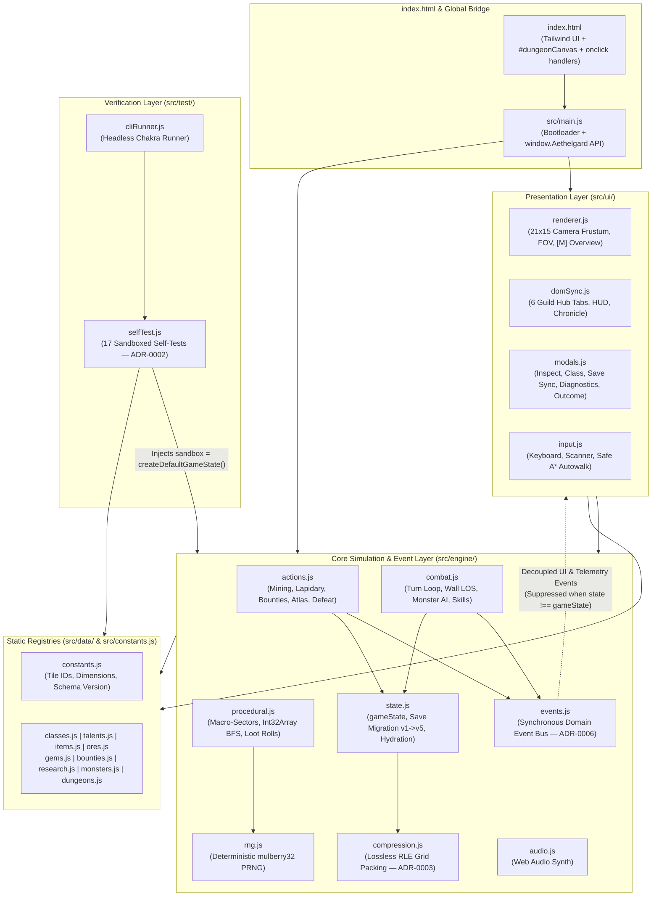

# Aethelgard Agentic Development Workflow (`v0.4.6-arch`)

> [!IMPORTANT]
> **Living Architecture Document**: Update this document and its diagrams whenever new quality gates, skills, hooks, or subagent workflows (Stages `W1`–`W4` in [`agentic_workflow_roadmap.md`](./agentic_workflow_roadmap.md)) are added to the repository.

---

## 1. End-to-End Agentic SDLC Loop (Current State)

This diagram illustrates the complete lifecycle of an AI pair-programming task or feature increment in **Aethelgard: The Starfall Vaults** as of `v0.4.6-arch`.

```mermaid
flowchart TD
  subgraph Context["1. Context & Guardrail Ingestion"]
    U["User Request / Increment Goal"]
    R1["Always-On Rules\n(GEMINI.md, AGENTS.md)"]
    R2["Domain Rules\n(.agents/rules/architecture, engine, testing, ui.md)"]
    ADR["Architecture Memory\n(docs/adr/ADR-0001..0006, architecture.md)"]
    SK["On-Demand Skills (Progressive Disclosure)\n(.agents/skills/increment-delivery, verification-runner, modular-refactor)"]
  end

  subgraph Plan["2. Specification & Design Alignment"]
    SPEC["Cross-Check Specs\n(roadmap.md, game_design_spec.md)"]
    ART["Implementation Plan Artifact\n(RequestFeedback: true)"]
    APP["User Review & Approval Gate"]
  end

  subgraph Impl["3. Strict Topological Implementation (src/)"]
    S1["1. Constants & Schema\n(src/constants.js, src/engine/state.js + migrateSaveData)"]
    S2["2. Pure Data Catalogs\n(src/data/*.js — zero engine/UI imports)"]
    S3["3. Sandboxed Engine & Events\n(src/engine/*.js — state = gameState, emitEngineEvent)"]
    S4["4. Presentation & Input\n(src/ui/*.js, index.html, src/main.js window.Aethelgard)"]
    S5["5. Cumulative Sandboxed Self-Tests\n(src/test/selfTest.js — Tests 1..20+)"]
  end

  subgraph Verify["4. Automated Verification Pipeline (./scripts/test.ps1)"]
    G1["Gate 1: Module Graph & Top-Level Collision Check\n(scripts/build.ps1 -> dist/bundle.js)"]
    G2["Gate 2: HTML DOM ID Contract (154 IDs)\n& window.Aethelgard API Contract (78 Exports)\n& Golden Rule / ES2017 Static Gate"]
    G3["Gate 3: Headless Chakra ES2017 Self-Test Suite (20/20 PASS)\n+ Headless UI, 7-Tab Guild Hub, Atlas & Canvas Smoke Suite"]
    G4["Optional Gate 4: In-Browser Diagnostics\n(index.html 'Verify Inc-5' modal & visual check)"]
  end

  subgraph Release["5. Milestone Release & Documentation Sync"]
    DOC["Update Living Docs & ADRs\n(docs/adr/, architecture.md, roadmap.md)"]
    GIT["Conventional Commit, Annotated Tag & Push\n(git commit -> git tag -a v0.x.y -> git push origin main --tags)"]
  end

  U --> R1
  R1 --> R2
  R2 --> ADR
  ADR --> SK
  SK --> SPEC
  SPEC --> ART
  ART --> APP
  APP --> S1
  S1 --> S2
  S2 --> S3
  S3 --> S4
  S4 --> S5
  S5 --> G1
  G1 -->|"Pass"| G2
  G1 -->|"Collision / Missing Import"| S3
  G2 -->|"Pass (0 Missing IDs)"| G3
  G2 -->|"Missing DOM ID"| S4
  G3 -->|"17/17 PASS"| G4
  G3 -->|"Test / ES2017 Syntax Failure"| S3
  G4 --> DOC
  DOC --> GIT
```

---

## 2. Automated Build & Verification Pipeline (`./scripts/test.ps1`)

Because Aethelgard runs both as native ES6 modules (`http://`) and as a zero-dependency bundle (`file://` and headless Windows `chakra.dll`), `./scripts/test.ps1` executes a multi-stage verification pipeline on every run:

---

## 3. Architectural Layering & Data Flow Guardrails

To keep the codebase modular and testable in headless environments without a real browser DOM, the workflow enforces a strict Directed Acyclic Graph (DAG) across `src/`:

---

## 4. Current Workflow Inventory & File Map

| Layer | Files | Purpose in Workflow |
| :--- | :--- | :--- |
| **Root Playbooks** | [`GEMINI.md`](../GEMINI.md), [`AGENTS.md`](../AGENTS.md) | Always-on operational rules, 8 Golden Rules, and zero-regression mandate. |
| **Domain Rules** | [`.agents/rules/architecture.md`](../.agents/rules/architecture.md), [`engine.md`](../.agents/rules/engine.md), [`testing.md`](../.agents/rules/testing.md), [`ui.md`](../.agents/rules/ui.md) | Contextual constraints automatically injected when editing files. |
| **Agent Skills** | [`.agents/skills/increment-delivery/SKILL.md`](../.agents/skills/increment-delivery/SKILL.md), [`verification-runner/SKILL.md`](../.agents/skills/verification-runner/SKILL.md), [`modular-refactor/SKILL.md`](../.agents/skills/modular-refactor/SKILL.md) | Progressive-disclosure runbooks activated on demand for specific workflows. |
| **Architecture Memory** | [`docs/adr/README.md`](./adr/README.md) (`ADR-0001`–`ADR-0006`), [`docs/architecture.md`](./architecture.md), [`docs/game_design_spec.md`](./game_design_spec.md), [`docs/roadmap.md`](./roadmap.md) | Historical context, schema contracts, design formulas, and milestone roadmap. |
| **Automation Scripts** | [`scripts/build.ps1`](../scripts/build.ps1), [`scripts/test.ps1`](../scripts/test.ps1), [`scripts/pre-commit.ps1`](../scripts/pre-commit.ps1), [`scripts/install-git-hooks.ps1`](../scripts/install-git-hooks.ps1) | Zero-dependency ES6 bundler, contract checker, pre-commit hook, and Chakra test runner. |
| **Future Evolution** | [`docs/agentic_workflow_roadmap.md`](./agentic_workflow_roadmap.md) | Staged roadmap (`W1`–`W4`) for static contract expansion, headless UI smoke tests, lifecycle hooks, and subagent QA auditing. |
