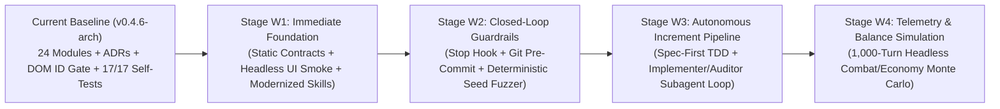

# Agentic Development Workflow Roadmap & Plan

This roadmap defines a pragmatic, incremental path to evolve Aethelgard's AI development workflow from **guided pair-programming** into a **high-autonomy, self-verifying engineering pipeline**—building each layer only when its value outweighs its complexity.

- **Current Workflow Architecture & Diagrams**: See [`docs/agentic_workflow.md`](./agentic_workflow.md) for the detailed diagrams of our active `v0.4.6-arch` workflow.

---

## 1. Current Workflow Audit (`v0.4.6-arch`)

| Capability Layer | Current State (`v0.4.6-arch`) | Gap / Opportunity for Higher Autonomy |
| :--- | :--- | :--- |
| **Rules & Architecture Memory** | `GEMINI.md`, `AGENTS.md`, `.agents/rules/*.md`, `docs/adr/ADR-0001..0006`, and `docs/agentic_workflow.md` are aligned to `v0.4.6-arch`. | `.agents/skills/*` (`increment-delivery`, `verification-runner`, `modular-refactor`) still reference `v0.3.1` (`10/10` tests) and omit ADR/DOM/UI-smoke steps. |
| **Build & Static Analysis Gates** | `scripts/build.ps1` checks circular imports & top-level declaration collisions; `scripts/test.ps1` checks `getElementById` IDs. | No static gate for: (1) `window.Aethelgard` `onclick` contract in `index.html`, (2) banned browser dialogs (`alert`/`confirm`/`prompt`), or (3) explicit ES2017 syntax checks (`?.`, `{...}`). |
| **Automated Runtime Verification** | `17/17` deterministic headless engine self-tests via `chakra.dll` (`~1.2s`). | Engine tests don't automatically exercise DOM rendering (`updateAllUI`, all 6 Guild tabs) or randomized multi-turn gameplay fuzzing unless we run a scratch script. |
| **Closed-Loop Enforcement (Hooks)** | Agent runs `./scripts/test.ps1` by instruction. | No automated lifecycle hook (`.agents/hooks.json` `Stop` hook) or Git `pre-commit` hook to guarantee `dist/bundle.js` is never stale and tests are never skipped. |
| **Autonomous Multi-Step Delivery** | Single agent plans, implements, and tests in one context. | For larger milestones, having a dedicated **QA & Invariant Auditor subagent** review diffs and try to break new features catches subtle balance/UI edge cases before human review. |

---

## 2. Staged Maturity Model (Develop as It Makes Sense)

---

## 3. Detailed Stage Breakdown & Priority Backlog

### Stage W1 — Immediate Foundation: Static Contracts, Headless UI Smoke & Skill Sync *(Completed)*
**Status**: **Implemented & Active in `scripts/test.ps1` and `.agents/skills/`**
**Goal**: Eliminate every class of error we previously had to catch manually or with one-off scratch scripts, and bring `.agents/skills/` up to `v0.5.0-inc5`.

1. **Expand `scripts/test.ps1` Static Contract Gates**:
   - **`window.Aethelgard` HTML Handler Contract**: Parse every `window.Aethelgard.<fnName>(` in `index.html` and `src/ui/` and verify `<fnName>` is exported on `AethelgardAPI` in `src/main.js`.
   - **Golden Rule Static Assertions**: Scan `src/` to block `window.alert(`, `window.confirm(`, `window.prompt(`, and flag ES2020+ tokens (`?.` optional chaining, `{ ...` object spread) with exact file and line numbers before `chakra.dll` even runs.
2. **Built-in Headless UI & Guild Tab Smoke Runner (`scripts/test.ps1`)**:
   - Promote our scratch DOM smoke check into `scripts/test.ps1` as a standard verification phase after `runSelfTests()`:
     - Bootstraps `updateAllUI()`, iterates through all 7 Guild tabs (`tavern`, `shop`, `assay`, `lapidary`, `research`, `bounties`, `talents`, `codex`), enters a dungeon (`descendIntoDungeon()`), executes a turn (`handlePlayerAction(1, 0)`), toggles Map Overview (`openFullMapModal()`), and opens/closes modals—asserting zero uncaught exceptions.
3. **Modernize `.agents/skills/`**:
   - Updated `.agents/skills/increment-delivery/SKILL.md`, `verification-runner/SKILL.md`, and `modular-refactor/SKILL.md` to match `v0.5.0-inc5` (`20/20` tests, ADR updates, DOM contracts, pre-commit hook runbooks, and `docs/agentic_workflow.md` maintenance).

---

### Stage W2 — Closed-Loop Guardrails: Lifecycle Hooks & Chaos Seed Fuzzer *(Completed)*
**Status**: **Implemented & Active in `.agents/hooks.json`, `.githooks/`, and `scripts/`**
**Goal**: Make quality self-enforcing so an agent *cannot* stop on a broken build or commit untested code.

1. **Git Pre-Commit Hook (`scripts/pre-commit.ps1` + `scripts/install-git-hooks.ps1`)**:
   - Configures `core.hooksPath` to `.githooks` with fallback to `.git/hooks/pre-commit`.
   - Runs full verification pipeline before finalizing any commit.
   - Automatically stages freshly compiled `dist/bundle.js` if `src/` or `index.html` is staged.
2. **Antigravity `Stop` Hook (`.agents/hooks.json` + `scripts/hook-verify-on-stop.ps1`)**:
   - Registered in `.agents/hooks.json` for the `Stop` lifecycle event.
   - Non-intrusively allows completion in `<50ms` when no code is touched.
   - If `src/` or `index.html` is modified, automatically runs `scripts/test.ps1`. If tests fail, it forces continuation (`"decision": "continue"`) and instructs the agent to fix the regressions before finishing its turn.
3. **Deterministic Chaos / Seed Fuzzer (`scripts/fuzz.ps1` & `runChaosFuzzer()`)**:
   - Simulates 25 random dungeon configurations across all 4 size tiers (`compact` through `colossal`) and all 4 layout styles (`masonry_vaults`, `excavation_quarry`, `crystalline_caverns`, `grand_ruins`).
   - Simulates 100 random valid turns per seed (2,500 total turns) covering class skills, tonics, navigation, RLE compression roundtrips, and pure-floor BFS invariants with zero runtime crashes.

---

### Stage W3 — High-Autonomy Subagent Delivery Loop
**When to Execute**: For large, multi-system milestones or `/goal` autonomous runs.
**Goal**: Enable "hands-off" delivery of entire feature increments using structured multi-agent verification.

1. **Spec-First Test Skeleton Pattern**:
   - Before writing feature code in `src/engine/` or `src/ui/`, the agent first writes the new sandboxed tests (`Test N+1..N+k`) and contract assertions, confirming they fail for the expected reason, then implements until green.
2. **Dual-Agent Implementer + QA Auditor Protocol (`.agents/skills/autonomous-increment/SKILL.md`)**:
   - **Primary Agent (Architect/Implementer)**: Designs the plan, implements `src/data/`, `src/engine/`, `src/ui/`, and unit tests.
   - **Subagent (Independent QA & Golden-Rule Auditor via `invoke_subagent`)**: Given only the spec, `AGENTS.md`, and the `git diff`, audits the implementation for Golden Rule violations, save-migration edge cases, Chakra compatibility, and missing tests, reporting findings back to the primary agent before the user reviews.

---

### Stage W4 — Automated Balance & Telemetry Monte Carlo
**When to Execute**: Post-Increment 5 endgame tuning & polish.
**Goal**: Use the Domain Event Bus (`src/engine/events.js`) to validate game balance autonomously.

1. **Headless Combat & Economy Simulator (`scripts/sim-balance.ps1`)**:
   - Subscribes to `ENGINE_EVENTS` (`MONSTER_SLAIN`, `ORE_MINED`, `HERO_DEFEATED`, `EXTRACTED`) over 500 simulated descents across all 5 classes (`fighter`, `thief`, `mage`, `ranger`, `paladin`).
   - Outputs survival rates per floor, average Gold/Minerals per run, and TTK (Time-To-Kill) ratios so new monsters, bosses, or items never accidentally break progression curves.
